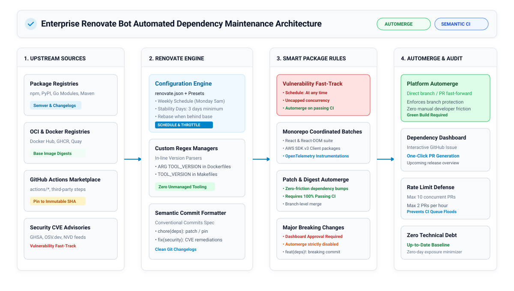

# Enterprise Renovate Automated Dependency Maintenance

[](https://github.com/tayyabmasood911/renovate-automated-dependency-updater/actions)
[](SECURITY.md)
[](LICENSE)
[](https://docs.renovatebot.com)
[](#)

An enterprise-grade Renovate Bot configuration suite engineered for automated software dependency hygiene, vulnerability patch fast-tracking, regex-based custom tool management, semantic commit adherence, and safe automerging.

---

## Architectural Blueprint

The Renovate maintenance pipeline pairs upstream registries, CVE security advisories, AST manifests, and custom regex parsers with intelligent grouping and automerge safeguards.



---

## Core Enterprise Capabilities

- **Automated Security Patch Fast-Track:** Immediately pulls upstream CVE patches from GHSA/OSV advisories (`schedule: at any time`), assigns `fix(security)` semantic commits, and automerges upon green test suites.
- **Custom Regex Managers:** Extends Renovate beyond standard lockfiles to track pinned tool versions inside `Dockerfile` (`ARG TOOL_VERSION=...`) and `Makefile` (`TOOL_VERSION ?= ...`).
- **Smart Monorepo Grouping:** Batches updates for complex multi-package monorepos (React, AWS SDK v3, OpenTelemetry) into single atomic pull requests, eliminating build breakages and notification spam.
- **Branch Protection & Automerge:** Automatically merges non-breaking patch and digest updates directly via GitHub branch automerge, strictly gating merges on passing CI tests.
- **Major Version Safety Gates:** Isolates breaking major updates behind mandatory Dependency Dashboard manual approval checkboxes with minimum 3-day stability buffers.

---

## Configuration Reference: `renovate.json`

### Key Policy Attributes

| Directive | Configuration | Impact |
|:---|:---:|:---|
| `schedule` | `before 5am on monday` | Prevents PR fatigue during working hours while leaving security patches unconstrained. |
| `prConcurrentLimit` | `10` | Limits open dependency PRs to avoid overwhelming developer review queues. |
| `prHourlyLimit` | `2` | Throttles CI runner load and GitHub token rate limits. |
| `stabilityDays` | `3` | Withholds releases under 3 days old to protect against supply chain tampering. |
| `semanticCommitType` | `chore` / `fix` / `feat!` | Standardizes Git commit log entries according to Conventional Commits. |

---

## Custom Regex Managers

Renovate updates unmanaged tool binaries in non-standard manifests via regex comments:

### 1. In `Dockerfile`:
```dockerfile
# renovate: datasource=github-releases depName=aquasecurity/trivy
ARG TRIVY_VERSION=v0.58.2
```

### 2. In `Makefile`:
```makefile
# renovate: datasource=github-releases depName=hashicorp/terraform
TERRAFORM_VERSION ?= 1.7.5
```

---

## Local Verification & Testing

```bash
# Execute unit test suite verifying schema and regex compilation
python3 -m unittest discover -s tests -p "test_*.py"

# Validate JSON schema and regex patterns
bash scripts/validate-config.sh

# Run healthcheck
bash scripts/healthcheck.sh
```

---

## Security Governance & Disclosure

For security vulnerabilities or supply chain concerns, consult our [Responsible Disclosure Policy](SECURITY.md) or contact maintainer **Tayyab Masood** at [tayyabmasood911@gmail.com](mailto:tayyabmasood911@gmail.com).

---

## License

Licensed under the MIT License. See [LICENSE](LICENSE) for details.
